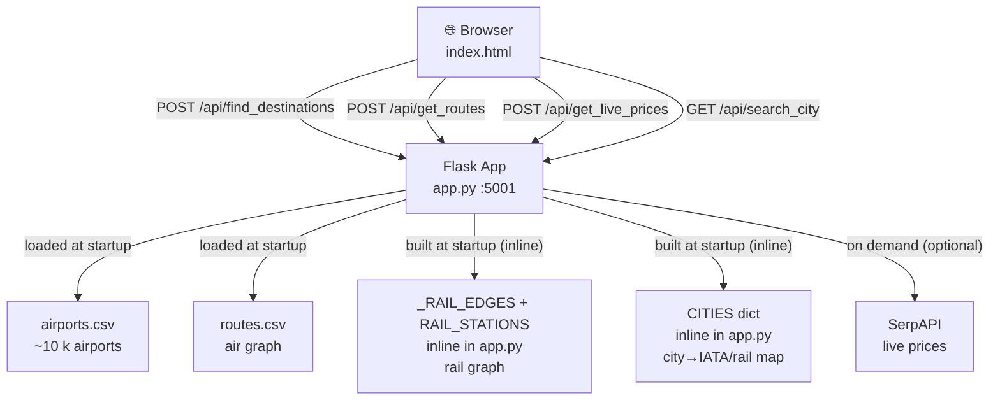
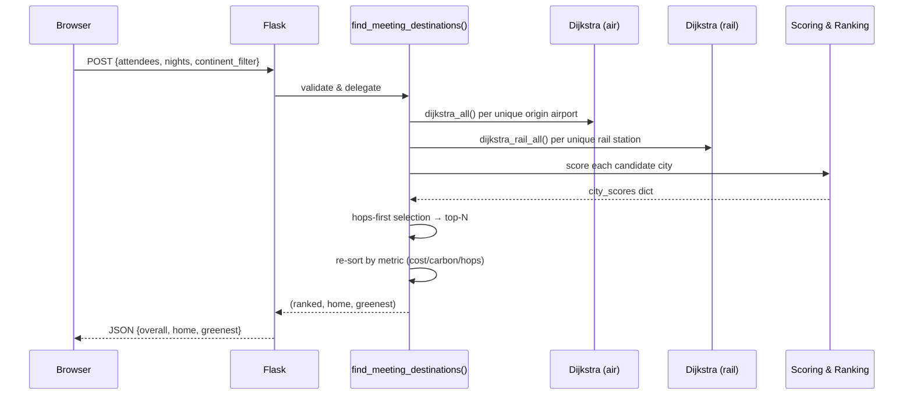
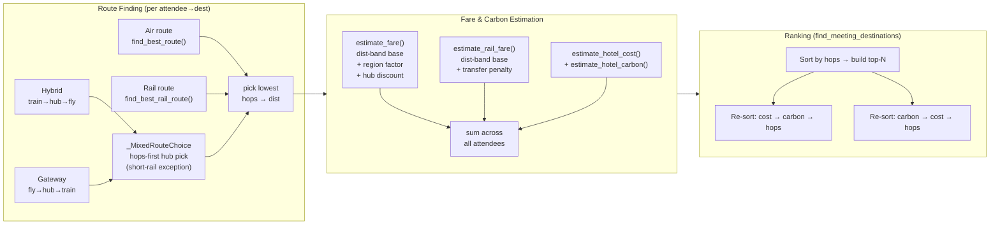

# MeetingCalculator — Architecture Diagrams

## 1 · System Architecture

## 2 · find_destinations Request Flow

## 3 · Routing & Scoring Pipeline

### Hub selection for mixed modes (`_MixedRouteChoice`)

The two mixed modes are mirror images — **hybrid** is train→hub→fly (rail-only
origin) and **gateway** is fly→hub→train (air origin → rail destination) — but
they pick their hub with **one shared rule**, so they can't drift apart:

- the candidate with the **fewest total hops** wins, ties broken by price;
- **except** a candidate whose rail leg is short (≤ `_SHORT_RAIL_KM`, 300 km) may
  win on price alone.

In other words a higher-hop itinerary only wins when its train is a quick hop —
never because a long, under-priced rail leg looks cheap. Without this guard the
fare model's under-pricing of long international rail produced absurd routes
(e.g. Lausanne→Balıkesir riding rail all the way to Istanbul, or Beijing→Sheffield
flying to a marginally-cheaper Brussels then training across the Channel).

The rule lives in **one place** — the `_MixedRouteChoice` selector — and is reused
by all four call sites: the hybrid and gateway branches of
`get_routes_for_destination()` (the drilldown) **and** the `hybrid_cost_maps` /
`gateway_cost_maps` builders in `find_meeting_destinations()` (the ranking), so
the table totals always match the route drilldown.

### A city is its airports (both ends)

A multi-airport city is a **single destination spanning all its airports**, so
each attendee independently lands at whichever airport is best for them:

- **European rail cities** are grouped by the `CITIES` dict (Paris = CDG + ORY),
  with `IATA_TO_CITY` mapping each airport back to its city-code.
- **Non-CITIES cities** are grouped at startup by `(city, country)` into
  `AIRPORT_CITY_GROUP` / `AIRPORT_CITY_REPR` (built next to `MAIN_AIRPORTS`).
  Each city collapses to one **representative** airport — the best-connected one
  — which keys its ranking row. Helpers `city_airports()` / `city_repr()` expose
  the grouping; `_dest_airports_and_rail()` and `get_routes_for_destination()`
  use it so the destination side sees every airport, just as an origin attendee
  already carries all of theirs.

Without the non-CITIES grouping the two ends were asymmetric: an origin used all
its airports but a destination used only the single IATA passed — so
London→Bangkok routed to DMK via Madras (no London nonstop into DMK) while
Bangkok→London flew BKK nonstop. Grouping makes both pick BKK.

> Caveat: grouping keys on the airports CSV's `city` string, so distinct metro
> airports filed under different city names stay separate (e.g. Newark/EWR is
> not grouped with New York's JFK + LGA).
